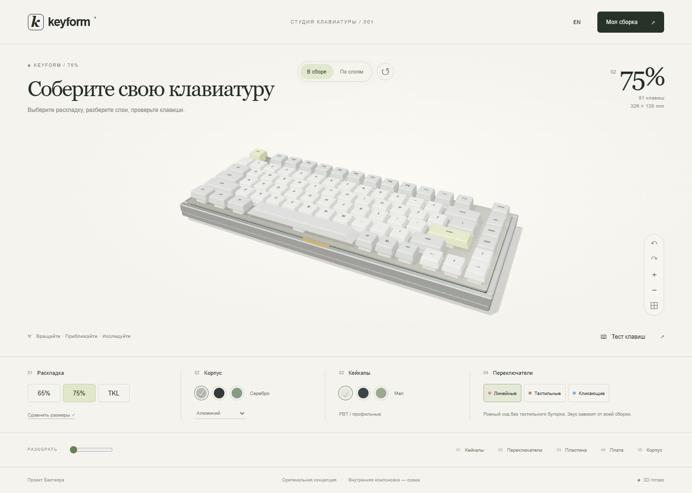

# Keyform

[Открыть студию](https://moyisey.github.io/keyform/) · [Исходный код](https://github.com/MOYISEY/keyform)

Keyform — интерактивная студия концептуальной механической клавиатуры в портфолио Бахтияра. Выберите компоновку 65%, 75% или TKL, корпус и кейкапы, рассмотрите пять механических слоёв, сравните размеры и проверьте клавиши. Модель строится процедурно на React, TypeScript и Three.js: внешние 3D-модели и текстуры не скачиваются.



[Вид по слоям](docs/keyform-exploded.png) · [Мобильный экран](docs/keyform-mobile.png)

Раздел «Моя сборка» позволяет импортировать и экспортировать JSON, скачать текстовый состав, создать ссылку на конфигурацию, а также по явному действию сохранить и восстановить сборку на этом устройстве.

**Это концепция, а не товар для заказа.** Размеры — проектные ориентиры; дорожки платы, корпуса переключателей и внутренняя сборка показаны схематично. Совместимость с реальными компонентами, цена, звук и пригодность к производству не заявлены.

## Локальный запуск и проверки

Нужны Node.js 22.12+ или 24 и npm:

```sh
npm ci
npm run dev
```

Сервер использует `127.0.0.1:5193` со строгой проверкой порта и не останавливает процессы других проектов. В отдельном терминале:

```sh
npm test
npm run build
npm run preview
```

Для браузерных тестов оставьте сервер предварительного просмотра работающим и запустите `npm run test:e2e`. На Windows тесты используют установленный Microsoft Edge, на других платформах — Playwright Chromium (`npx playwright install chromium`). Адрес можно переопределить через `KEYFORM_URL`, включая завершающий `/`. Существующий CI проверяет модульные и браузерные тесты с production-сборкой, затем публикует её в GitHub Pages.

## Структура

- `src/model.ts` — строгая проверка версионной конфигурации, кодирование ссылки, список деталей, координаты клавиш и описания компонентов на двух языках.
- `src/KeyboardScene.tsx` — процедурная 3D-модель, атлас надписей и окружение, выбор деталей лучом, управление мышью/касанием, разнесённые слои, рендеринг по запросу и освобождение ресурсов.
- `src/App.tsx` — доступные элементы управления на русском и английском, управление фокусом диалогов, импорт/экспорт, необязательное локальное сохранение и ограниченный полем тест клавиш.
- `src/style.css` — адаптивная компоновка и поддержка reduced motion.
- `tests/` — инварианты состояния, недоверенный ввод, браузерные сценарии и кадры.

## Приватность и ограничения

Нет аналитики, cookies, сервера или удалённых ассетов. Обработчики физических `keydown`/`keyup` действуют только в явно включённом текстовом поле. При выходе тест прекращается; Escape выводит из поля, Tab сохраняет обычную навигацию. Текст теста очищается при закрытии и никогда не сохраняется, не попадает в ссылки или экспорт. Экранная клавиатура проверяет позиции клавиш концепции; сочетания ОС и аппаратный Fn нельзя универсально наблюдать из браузера.

Ссылка содержит только семь проверенных свойств конфигурации. Локальное хранилище записывается лишь после «Сохранить на устройстве». Неверный, чрезмерно большой файл или файл неизвестной версии не меняет текущую сборку. При сбое WebGL остаются схематичный 2D-вид, конфигуратор, тест и экспорт. Это не устанавливаемое офлайн PWA: для первой загрузки нужен локальный сервер или доступ к опубликованному сайту.

## Авторство и зависимости

Меши клавиатуры, надписи на клавишах, цвета материалов, интерфейс и знаки созданы в этом проекте. Референсные видео, сторонние модели устройств, шрифты и фотографии товаров не распространяются. React, Three.js и инструменты разработки сохраняют собственные лицензии; см. [THIRD_PARTY.md](THIRD_PARTY.md) и lock-файл. Отдельной лицензии на исходный код Keyform в репозитории нет.
